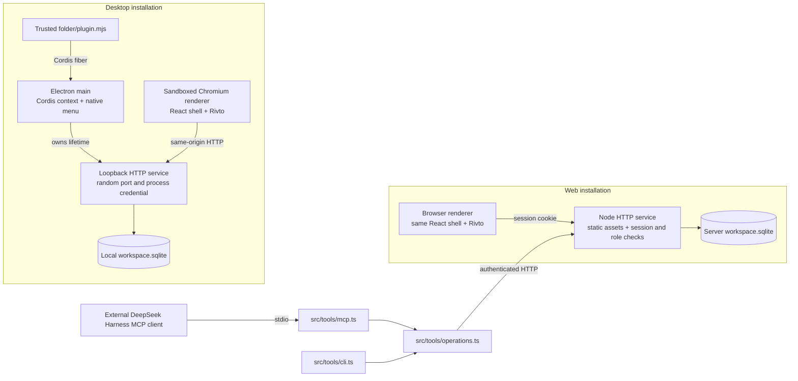
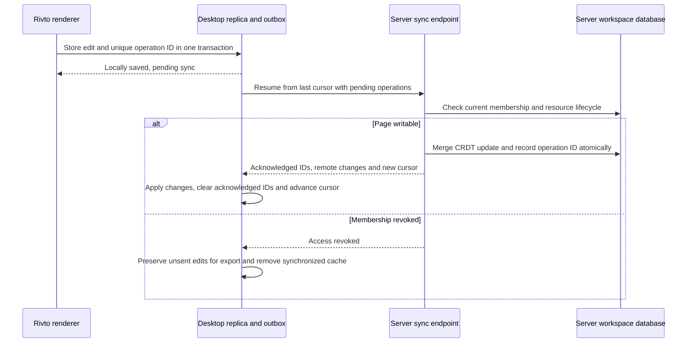

# Chulane POC architecture

**One React application serves two deployment models.** Electron starts a private SQLite-backed service on the same device. The browser connects to a separately deployed instance of that service. Both load the same compiled Rivto renderer and use the same HTTP operations. Each service owns its own data. Two browsers on one service can collaborate today. Connecting the databases owned by two different services requires a replication protocol.

The November 16 PRD on Chulane main commit `a611c2e` is the product baseline. This branch started from an earlier starter, so a copy of that PRD accompanies the POC. The current code and the remaining release design are described separately below. [Product requirements](../../dev_notes/chulane_prd.md) · [Scenario-by-scenario evidence](FEASIBILITY.md)

## Source layout

| Directory | Owner |
|---|---|
| `src/renderer/` | React workspace shell, Rivto document host, browser API client and styles |
| `src/shared/` | Library response types used by the renderer and tools |
| `src/server/` | Shared HTTP/SQLite service and standalone web entry point |
| `src/desktop/` | Electron main process and native plugin lifecycle |
| `src/tools/` | CLI, MCP server and their shared client operations |
| `tests/integration/` | Node tests against real HTTP endpoints, SQLite storage and the CLI |
| `tests/e2e/` | Rendered workflows in Chromium and Electron |

## Running processes and trust boundaries



| Owner | Responsibilities | Entry point |
|---|---|---|
| Renderer | Navigation, workspace and project selection, journal, search, file controls, approval UI. React state holds the current view and transient messages. | [src/renderer/app.tsx](src/renderer/app.tsx) |
| Document host | Restore Yjs state before mounting Rivto, own one document/core/React runtime per open page, poll, merge and save. Page and canvas borrow the same runtime. | [src/renderer/editor.tsx](src/renderer/editor.tsx) |
| Rivto | Block tree, canvas elements, editing, rendering, document transactions and undo within the mounted runtime. Standard, page-drag and edgeless extensions provide the editing surface. | [Pinned upstream source](https://github.com/MalchuL/rivto/tree/a49ae45fa6a64eac3c4070cb7121933ecbac5dd0/packages) |
| Workspace service | Access check, storage schema, request limits, page and project operations, transactional approval, asset serving. Both entry points invoke the same `serve` function. | [src/server/service.ts](src/server/service.ts) |
| Desktop host | Native window, sandbox, navigation policy, transient authentication, plugin consent and lifecycle. A Cordis fiber owns the service and closes it on disposal. | [src/desktop/main.ts](src/desktop/main.ts) · [src/desktop/plugins.ts](src/desktop/plugins.ts) |
| Web deployment | Data directory, credentials, bind address and port. One Node process serves assets and API. Docker persists the database on a named volume. | [src/server/main.ts](src/server/main.ts) · [Dockerfile](Dockerfile) |
| External tools | Convert CLI arguments or MCP input schemas into the same authenticated HTTP operations. Search results carry stable page links. An editor must approve proposed writes. | [src/tools/operations.ts](src/tools/operations.ts) · [src/tools/mcp.ts](src/tools/mcp.ts) |

**Why an embedded HTTP service?** It lets the Linux desktop exercise the exact persistence and authorization paths used by a browser. Electron adds the process credential only to requests from its own window to the exact service origin. Renderer JavaScript receives neither the credential nor Node APIs. External navigation and secondary windows are blocked. Desktop can start without DNS, a remote server or a provider key. Its loopback address changes at relaunch, so desktop page URLs are session-local.

**What a web key means.** An installation has an editor key and an optional viewer key. A successful JSON login issues a random, HTTP-only, SameSite=Strict session cookie. The service checks the session and role on every API request, including attachment downloads and proposal decisions. A viewer can see all workspaces on that installation. Changing keys requires restarting the process and signing in again. Workspace selection scopes navigation and project assignment. It provides no tenant isolation. A release needs named principals and membership checks on the addressed resource.

The shared renderer imports Rivto’s pinned shadcn/ui controls through `src/renderer/ui/index.ts`. The Item, Alert and Empty components in that directory come from the shadcn/ui new-york-v4 registry and use the same Tailwind theme. The React shell owns navigation and save state. Radix handles the dialog, popover and toggle-group interactions in both hosts.

## From a keystroke to durable state

1. The renderer opens `GET /api/pages/:id/state`. It applies the stored bytes to a fresh `Y.Doc`, wraps it with Rivto's `YjsDoc` and `DocumentModelImpl`, and mounts `EditorPanel`. Surface switching retains the model and page ID.
2. A local Yjs update marks the page dirty and shows **Unsaved changes**. One timer fires five minutes after opening. It requests a database save if edits are pending. A click or focus change outside the Page or Canvas surface requests a checkpoint when there are pending edits. The shell awaits the editor’s shared checkpoint before navigating to another document, workspace or list. If more edits arrive during that write, navigation waits for their acknowledgment too. A failed save keeps the editor mounted. **Save now** also requests a checkpoint. Independent 500 ms polls exchange changes with the server. Slow requests serialize.
3. An editor publishes changed Yjs state to an authenticated, versioned in-memory draft. Other open clients fetch and merge it on their next poll. Live revisions are negative. A save promotes the merged state and writing projection to SQLite in one conditional update and clears the draft. Search, exports based on the saved projection and cold backups see the database version. Restarting the server discards volatile drafts.
4. If the revision changed underneath that request, the server returns 409. The next check fetches the winning binary state, merges it into the still-live local Y.Doc, and retries. Applying a remote update alone does not mark the editor dirty. A client at the current revision receives a 204 without a state body.
5. A successful acknowledgment clears the dirty indicator after all edits covered by that save have reached the owning database. **Saved** refers to that database. Closing the process before acknowledgment can lose recent changes. On web, unsent changes exist only in the open tab. Desktop uses its local service even when the external network is unavailable.

This full-state protocol fits small documents and makes conflict handling inspectable. It transfers the whole document on each revision and computes its writing projection on the renderer. Independent browser edits against the same revision converged in the rendered smoke test. Disconnected-device recovery, competing metadata changes, hostile editor clients and large documents need a stronger protocol. Revision checking assumes the client honestly merges the previous state. A malicious editor with write access can replace document contents or misstate the search projection.

## Storage and invariants

| Record | Durable data and invariants |
|---|---|
| Workspace | Integer identity and name. A new database starts with one personal library. Users can create more workspaces. IDs are local to that database. |
| Project | Workspace foreign key and name. This version supports one hierarchy level. |
| Page | Workspace and optional project, title, optional date-only journal key, trash flag, binary body, revision and writing projection. Duplicate titles are allowed. Project moves retain ID and content. `UNIQUE(workspace,day)` serializes same-day creation on one service. |
| Attachment | Foreign key to page, original file name and bytes. Download is served as an attachment. The request limit is 16 MiB per file. Page trash retains attached bytes. |
| Tool proposal | Workspace, optional target page, proposed title and decision. Approval checks the current editor session, verifies the target, applies the operation and consumes the pending decision in one transaction. Repeated approval returns a conflict. |

SQLite is canonical on each host. A Markdown import creates a new page with its text present from the first insert. Its first editable open initializes the binary Rivto document. Export uses the writing projection, and the UI reports omitted rich content. A backup captures complete editor state, files and proposal records. Library search in the renderer filters the loaded writing projections and titles. External search calls `GET /api/search?workspace=&q=`. The service authenticates the request, selects active pages in that workspace and passes them to `PageRetriever.search`. It rechecks the returned IDs against current rows and returns up to 30 titles and IDs. Both MCP and CLI turn those IDs into links. Opening a result for a tool calls `GET /api/source?workspace=&id=`, which independently checks the source. The default retriever performs literal case-insensitive matching. A retrieval plugin can provide a different ranking without gaining authority to disclose other rows. [Retrieval contract](src/server/retrieval.ts)

The library endpoint presently ships the saved writing projection for every page. Large libraries need bounded candidate loading, pagination and a separately maintained index.

## Plugins and Harness

The repository already vendors MIT-licensed Cordis from DeepSeek Harness. The POC bundles that source into Electron main. The native plugin menu loads a user-confirmed local `plugin.mjs` and calls `ctx.plugin`. A plugin can register a native command with `ctx.effect(() => command(label, action))`. Disposing the fiber removes the command. The desktop remembers each folder and enabled state. Removing the registration leaves the source folder and any plugin-owned data on disk. These modules have the user's full desktop privileges. The sample adds a native command; renderer slots and editor-block extension registration are future work. [Vendored revision and license](../../vendor/README.md) · [Example plugin](examples/reading-break/plugin.ts)

DeepSeek Harness and its MCP client declare an MIT license at the inspected revision. [Upstream license](https://github.com/deepseek-ai/deepseek-harness/blob/2e39e70496aa02986ca6a820c5d497e816b69d7e/LICENSE)

For external agents, the supported integration seam is Harness's MCP client. It launches the Chulane stdio server and exposes its registered tools to an external Harness agent. The application supplies six knowledge operations; Harness owns model selection, agent execution and its session history. The SDK smoke exercises proposal approval in the browser. A second smoke starts the published Harness CLI with the app’s Cordis overlay and calls `mcp__chulane__search` through `ctx.tools.execute`. The executor returns a real page citation. This verifies tool discovery, transport and execution independently of model inference. [Harness smoke](tests/e2e/harness.spec.ts) No Harness process or model is embedded in either renderer. [Harness MCP client](https://github.com/deepseek-ai/deepseek-harness/tree/2e39e70496aa02986ca6a820c5d497e816b69d7e/packages/mcp/mcp-client) · [Harness tools](https://github.com/deepseek-ai/deepseek-harness/tree/2e39e70496aa02986ca6a820c5d497e816b69d7e/packages/core/tools)

Rivto is a submodule pinned to the inspected `main` commit. Vite resolves workspace package sources and compiles the Page CSS before the React editor stylesheet. This preserves the independent Tailwind prefixes for the two packages. To update, fetch Rivto main, review its API and licensing changes, update the submodule pointer and local lockfile together, and repeat the build and both host smokes. There was no tracked repository-wide LICENSE file at the pinned Rivto revision. Distribution rights need confirmation before publishing packaged binaries.

## Built-in agent sidebar

The workspace shell owns the sidebar across page switches. Opening it loads shared history from SQLite. Sending captures the selected page ID and awaits the editor checkpoint. The renderer uses dnd-kit and a searchable picker to include additional page IDs with the message. The host resolves those references in the request workspace, records them as message sources and supplies their excerpts to the selected agent alongside the current document. Block links use a dedicated Rivto row slot. It captures the selection’s page and block IDs without issuing an editor mutation. The host resolves the IDs against live workspace documents at send time and persists the links on the user message. The browser keeps one HTTP response open for the foreground turn. The host stores each text delta before emitting it as newline-delimited JSON. A second viewer can read the same persisted conversation. [Sidebar](src/renderer/agent.tsx) · [Chat service](src/server/chat.ts)

```mermaid
sequenceDiagram
    actor U as Workspace editor
    participant UI as Sidebar and Rivto
    participant H as Authenticated host and SQLite
    participant A as Mastra agent
    participant P as OpenAI model
    U->>UI: Send message on page A
    UI->>H: Checkpoint A, start chat turn
    H->>A: History, current page blocks, scoped tools
    A->>P: Request with tool definitions
    P-->>A: Search and read page B
    A->>H: Read active workspace pages
    P-->>A: Propose block replacement
    A->>H: Store expected text and proposed text
    H-->>UI: Stream reply and display review
    U->>UI: Apply
    UI->>H: Apply proposal for B
    H->>H: Check role, page and original block; commit CRDT and decision
    H-->>UI: Result and link to changed block
```

Both production hosts mount the chat service through Cordis. Each API-backed turn constructs a Mastra Agent with three native tools, bound to the request workspace. Search uses the host retriever. Reads expose ordered block IDs and text in batches of up to 40 blocks and 24,000 characters. Replacement is available for fully observed blocks up to 12,000 characters. Append creates a paragraph. The host takes the expected text from its own read, looks up the current document again on approval, and edits through Rivto’s headless model. A single SQLite transaction stores the binary state, search projection, and applied decision. The runner sends up to 24 recent messages plus recorded edit outcomes and allows up to eight model steps. [Mastra adapter](src/server/mastra.ts) · [Document operations](src/server/agent-document.ts)

**Installed agent connections.** Orca hosts installed CLIs, OpenCode exposes `opencode acp`, and Zed connects external agents through ACP adapters. For Codex alone, its official non-interactive mode already provides the local login, stdin and structured output that a document turn requires. Chulane uses host-launched one-shot processes for Codex, Claude Code and Hermes, and replays bounded SQLite chat history on each turn. The host validates structured responses and dispatches only search, read and propose operations through the existing workspace service. Edit approval remains a separate user action. Each turn starts in a temporary directory. Stopping the turn aborts the child process. A final response arrives after a model step completes. ACP would become relevant for native agent thread resumption, rich tool progress or a larger adapter catalog. [Orca](https://orca.dev/docs/agents/supported) · [OpenCode](https://opencode.ai/docs/acp/) · [Zed](https://zed.dev/docs/ai/external-agents) · [OpenAI documentation](https://developers.openai.com/codex/noninteractive)

**Undo and concurrent edits.** When the approver has the target mounted, its renderer pauses polling during approval. The host returns the pre-edit state and the edit delta. The renderer merges the base as a remote update and applies just the approved delta inside a local Rivto transaction bounded by undo capture points. Other renderers merge it normally. A target that was closed at approval has no live undo stack. Concurrent changes to other blocks survive, and a change to the target text makes the proposal stale.

**Run lifetime.** Closing the sidebar preserves the HTTP connection. Switching documents changes the context of the next message. Closing the tab, stopping the response, or shutting down the host aborts the turn. Startup marks abandoned running messages interrupted. The host never resumes a mutation automatically. Review state belongs to SQLite and can outlive any model process. Background runs are future work.

**Provider ownership.** Desktop stores encrypted credentials separately from workspace data when the OS keychain is usable and falls back to an in-memory session. Web operators supply the key and model in the server environment. The client sends a setup key only to its own desktop host. The API returns connection status, the selected agent, model name and selectable local connections. The external Harness/MCP path continues to operate independently. [Configuration and verification](README.md#talk-to-the-built-in-agent)

## Architecture needed for the release

| Missing boundary | Proposed owner and data flow | Acceptance gate |
|---|---|---|
| Identity and workspace access | Server stores users, sessions, workspace memberships and roles. Resolve the principal on every read/write; invitations and ownership transitions run in transactions. Desktop maintains a local profile plus independent server identities. | Removing a member blocks reads, writes and file downloads without affecting another workspace. Last-owner removal fails. |
| Offline replicas | Desktop owns a durable replica per server workspace. Store CRDT updates and an outbox in the same local transaction. Authenticated replication service verifies current membership, acknowledges update IDs and supplies missing updates. Server-issued IDs or globally unique IDs replace installation-local integer identities for replicated entities. | Two devices edit offline, restart, reconnect and converge. Revoked changes remain exportable while accessible synchronized content is removed. |
| Metadata and deletion | Replicate record revisions and tombstones separately from document updates. Retain concurrent metadata values for user resolution. Give workspace archive, tombstone and purge distinct states and role checks. | Deleted pages stay deleted after replay; recovery preserves edits; stale devices cannot recreate purged data. |
| Knowledge model | Workspace owns tag/field definitions and durable application values by object ID, tag ID and field ID. Use stable Rivto block IDs for block targets. Keep values across detachment. Journal identity derives from workspace plus date in its configured time zone. | Reattachment restores former values; separate offline journal creations converge; tag tables link to accessible source blocks. |
| Retrieval and agent tools | A retrieval operation takes a principal, workspace, query and limits, and returns authorized page/block/file citations. Recompute derived indexes from canonical content. Persist shared chat, tool proposals, idempotent operation results and interrupted states in the workspace. | A real model cites an authorized document; mutation approval survives restart and rechecks access. Page navigation leaves a turn active; closing the client cancels foreground execution. |
| Extension and packaging | Desktop host owns trusted modules; renderer owns explicit, removable UI contributions; Rivto owns block registration and unknown-block retention. Keep signed installers, updates and OS-specific data-location checks at the host boundary. | Install, disable, reinstall and reopen a custom block; verify clean installations on Linux, Windows and macOS. |

The highest-impact design change is introducing authenticated replicas. It changes identity, persistence, synchronization status and deletion semantics together. Adding another Electron window or replacing polling with WebSockets alone would leave those requirements open.

### Proposed desktop reconnect sequence

This sequence describes the release design. Today a desktop installation has only its local database, and online collaboration uses a single service.



An acknowledgment lost in transit causes the desktop to retry the same operation ID. The server must recognize that ID after restart. A metadata conflict needs both values and their revisions. A tombstone needs a durable identity and an explicit recovery action. Those records have a different lifecycle from the Yjs document, so the synchronization service owns them. The web renderer can call the same server operations directly while connected.
