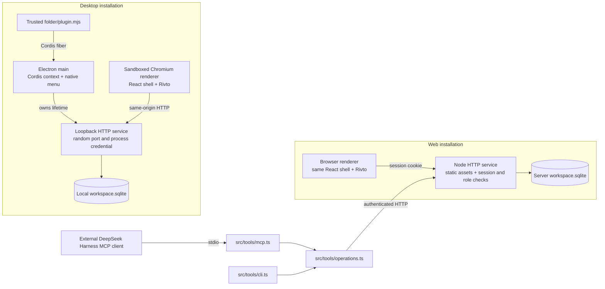
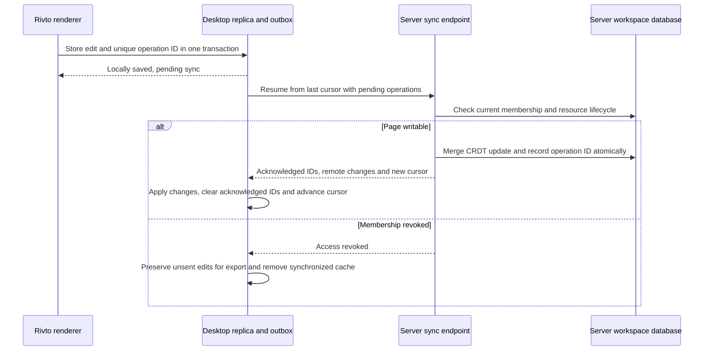

# Chulane POC architecture

**One React application serves two deployment models.** Electron starts a private SQLite-backed service on the same device. The browser connects to a separately deployed instance of that service. Both load the same compiled Rivto renderer and use the same HTTP operations. Each service owns its own data. Two browsers on one service can collaborate today. Connecting the databases owned by two different services requires a replication protocol.

The November 16 PRD on Chulane main commit `a611c2e` is the product baseline. This branch started from an earlier starter, so a copy of that PRD accompanies the POC. The current code and the remaining release design are described separately below. [Product requirements](../../dev_notes/chulane_prd.md) · [Scenario-by-scenario evidence](FEASIBILITY.md)

## Source layout

| Directory | Owner |
|---|---|
| `src/renderer/` | React workspace shell, Rivto document host, browser API client and styles |
| `src/shared/` | Library response types used by the renderer and tools |
| `src/server/` | Shared HTTP/SQLite service and standalone web entry point |
| `src/desktop/` | Electron main process and native plugin lifecycle |
| `src/tools/` | CLI, MCP server and their shared client operations |
| `tests/integration/` | Node tests against real HTTP endpoints, SQLite storage and the CLI |
| `tests/e2e/` | Rendered workflows in Chromium and Electron |

## Running processes and trust boundaries



| Owner | Responsibilities | Entry point |
|---|---|---|
| Renderer | Navigation, workspace and project selection, journal, search, file controls, approval UI. React state holds the current view and transient messages. | [src/renderer/app.tsx](src/renderer/app.tsx) |
| Document host | Restore Yjs state before mounting Rivto, own one document/core/React runtime per open page, poll, merge and save. Page and canvas borrow the same runtime. | [src/renderer/editor.tsx](src/renderer/editor.tsx) |
| Rivto | Block tree, canvas elements, editing, rendering, document transactions and undo within the mounted runtime. Standard, page-drag and edgeless extensions provide the editing surface. | [Pinned upstream source](https://github.com/MalchuL/rivto/tree/a49ae45fa6a64eac3c4070cb7121933ecbac5dd0/packages) |
| Workspace service | Access check, storage schema, request limits, page and project operations, transactional approval, asset serving. Both entry points invoke the same `serve` function. | [src/server/service.ts](src/server/service.ts) |
| Desktop host | Native window, sandbox, navigation policy, transient authentication, plugin consent and lifecycle. A Cordis fiber owns the service and closes it on disposal. | [src/desktop/main.ts](src/desktop/main.ts) · [src/desktop/plugins.ts](src/desktop/plugins.ts) |
| Web deployment | Data directory, credentials, bind address and port. One Node process serves assets and API. Docker persists the database on a named volume. | [src/server/main.ts](src/server/main.ts) · [Dockerfile](Dockerfile) |
| External tools | Convert CLI arguments or MCP input schemas into the same authenticated HTTP operations. A named profile binds the server origin, credential and workspace at process startup. Its authenticated session supplies the profile label and, for named accounts, the requester ID stored with the proposal. Approval checks that requester’s current membership in the same transaction as the mutation and decision. Search results carry stable page links. An editor must approve proposed writes. | [src/tools/operations.ts](src/tools/operations.ts) · [src/tools/mcp.ts](src/tools/mcp.ts) |

**Why an embedded HTTP service?** It lets the Linux desktop exercise the exact persistence and authorization paths used by a browser. Electron adds the process credential only to requests from its own window to the exact service origin. Renderer JavaScript receives neither the credential nor Node APIs. External navigation and secondary windows are blocked. Desktop can start without DNS, a remote server or a provider key. Its loopback address changes at relaunch, so desktop page URLs are session-local.

**Device appearance.** The renderer applies validated colors and typography to the application root and overrides Rivto’s public theme variables on the editor surface. The local Electron window reads and writes one theme in the device settings database through frame-checked IPC. Browser and remote Electron windows use origin-local storage keyed by the authenticated account profile. These settings stay outside the workspace database and its backup.

**Desktop server profiles.** Electron stores server origins in a device-local SQLite catalog. The local window’s preload exposes listing, opening and forgetting profiles. Main validates the calling frame and address. Each origin gets its own sandboxed browser session and remote windows have no preload. The picker fetches current workspace memberships through each origin’s session when opened or refocused. Remote pages use their server’s document and agent APIs. Only the local renderer receives the loopback bearer. Closing a remote window leaves other open editors intact. In a named-account remote window a service worker retains the built shell. The renderer caches authorized catalogs, libraries, document states, attachment lists and downloaded file bodies in its server partition. A successful upload supplies its stable file ID so Electron can cache the submitted bytes. Page and attachment availability is derived from the bodies present in the account cache. IndexedDB holds pending Yjs snapshots by installation, account, workspace, page and writer. An open editor merges recovered writers with the current server state, checks the server revision and retires only acknowledged versions. [Desktop profile host](src/desktop/server-profiles.ts)

A named workspace owner can mark an archived workspace for deletion. The server administrator can recover or purge a marked workspace without joining it. Recovery increments the workspace’s restoration counter in the same SQLite transaction. This changes its replica identifier even on devices that missed the entire deletion interval. The server checks the identifier again after reading a write body. Electron keeps pending documents and metadata changes under their original replica identifier. Whole-page tag changes record the existing tag ID and its requested assignment. Replay updates the same assignment row and respects page and tag Trash state. A named editor’s catalog also includes retained field values for inactive whole-page assignments so reapplying a tag offline restores the row. Viewers receive active assignment values. A queued page link records the destination ID and whether the link should exist. When the server acknowledges a link change it commits the relationship and its operation receipt in one SQLite transaction, so retrying it preserves later edits. **Review restored edits** explicitly delivers one selected page to the currently authorized replica and removes acknowledged edits from the original queue. Purged workspace IDs stay retired.

The workspace toolbar retries open editors and closed-page drafts through the same revision-checked document endpoint. Navigation and manual sync can wait on the same write. Navigation accepts a committed IndexedDB snapshot during an outage. Manual sync reports the upload failure until the server acknowledges the checkpoint. [Workspace sync](src/renderer/workspace-sync.tsx) · [Document outbox](src/renderer/document-outbox.ts)

**Recovery after membership loss.** The authenticated catalog identifies the installation and account even when its workspace list is empty. Chromium serializes per-profile cache updates across windows. A membership change invalidates inaccessible workspace libraries and document states. IndexedDB retains the original account’s pending full-document snapshots. The recovery dialog reads their source IDs, merges a selected page’s writer snapshots, and exports a versioned JSON file containing the writing projection and original Yjs update. Export is local and leaves replay receipts intact.

**Web identity and workspace access.** Accounts use case-insensitive usernames and salted scrypt password hashes stored in SQLite. Self-registration is an operator setting. Creating a workspace and its owner membership is one transaction. The host filters the catalog by account and resolves membership before opening workspace resources. Each agent tool call checks the initiating session again. Owners manage existing memberships by account ID. Role changes and removals validate the acting owner and count remaining owners inside one SQLite write transaction. Subsequent requests use the new membership even when the session cookie predates the change. Archive and journal settings recheck owner authority after reading the request body. Key-based installations retain access to their original shared library. Each workspace stores its access mode explicitly, so a missing account membership cannot expose a workspace to a shared key. Signing out or restarting the host invalidates the in-memory session cookie.

The shared renderer imports Rivto’s pinned shadcn/ui controls through `src/renderer/ui/index.ts`. The Item, Alert and Empty components in that directory come from the shadcn/ui new-york-v4 registry and use the same Tailwind theme. The React shell owns navigation and save state. Radix handles the dialog, popover and toggle-group interactions in both hosts.

## From a keystroke to durable state

1. The renderer opens `GET /api/pages/:id/state`. It applies the stored bytes to a fresh `Y.Doc`, wraps it with Rivto's `YjsDoc` and `DocumentModelImpl`, and mounts `EditorPanel`. Surface switching retains the model and page ID.
2. A local Yjs update marks the page dirty and shows **Unsaved changes**. One timer fires five minutes after opening. It requests a database save if edits are pending. A click or focus change outside the Page or Canvas surface requests a checkpoint when there are pending edits. The shell awaits the editor’s shared checkpoint before navigating to another document, workspace or list. If more edits arrive during that write, navigation waits for their acknowledgment too. A failed save keeps the editor mounted. **Save now** also requests a checkpoint. Typing schedules a live write after a short batching window. Each renderer shares one WebSocket subscription among editors in the same workspace and replica. A single-use ticket from the authenticated HTTP API authorizes the upgrade. The host rechecks access before sending a changed page ID. Each affected editor fetches its authorized Yjs update, with 500 ms polls for recovery and edits from other integrations. Slow requests serialize.
3. An editor publishes changed Yjs state to an authenticated, versioned draft. Before acknowledging it, the host writes the latest binary snapshot and its validated writing projection for that page to a SQLite journal. Other open clients fetch and merge it on notification or reconciliation. Live revisions use batches of negative numbers reserved in SQLite. Restarting the service skips the unused part of the last batch, so a stale tab receives a conflict and merges the current state. A save promotes the merged state and writing projection to SQLite in one conditional update and clears the draft. The catalog reflects the checkpointed version. A running-host backup includes acknowledged live snapshots. Search and source reads use the current live writing and canvas text when a draft exists. Search derives that text once per immutable live revision. An orderly shutdown drains active requests, then commits every remaining live draft and its writing projection in one SQLite transaction before closing the database. After an abrupt exit or backup restoration, startup promotes the journaled snapshots and their writing projections before accepting requests. Updating the checkpoint clears its journal entry in the same transaction.
4. If the revision changed underneath that request, the server returns 409. The next check fetches the winning binary state, merges it into the still-live local Y.Doc, and retries. Applying a remote update alone does not mark the editor dirty. A client at the current revision receives a 204 without a state body.
5. A successful acknowledgment clears the dirty indicator after all edits covered by that save have reached the owning database. **Saved** refers to that database. Closing the process before acknowledgment can lose recent changes. On web, unsent changes exist only in the open tab. Desktop uses its local service even when the external network is unavailable.

On initial open the host returns a complete snapshot. Editors echo the host’s Yjs state vector on subsequent reads so the server can return missing changes, including deletions. The desktop replica merges those bytes with its matching cached revision to retain a standalone offline copy. If that base has been evicted or replaced, it fetches a full snapshot. Older readers, oversized state vectors and updates as large as the snapshot use the full response. When the host advertises support for live PATCH requests, typing uploads carry changes since its last acknowledged Yjs state vector. The host checks the revision, reconstructs the complete snapshot, and journals it before replying with the new revision and vector. Without a usable vector the editor publishes a complete snapshot. Explicit checkpoints and closed-page offline replay also upload complete snapshots. The host derives the searchable writing from that state. Live updates, checkpoints, offline merges and reviewed agent edits share a 16 MiB limit on the encoded document. An approval that exceeds the limit leaves the proposal pending and preserves the current document revision. Older renderers can still send a prefixed writing projection. Independent browser edits against the same revision converged in the rendered smoke test. Disconnected-device recovery, competing metadata changes, hostile editor clients and large documents need a stronger protocol. Revision checking assumes the client honestly merges the previous state. A malicious editor with write access can replace document contents or supply an inaccurate search projection through the legacy frame. [Yjs document updates](https://docs.yjs.dev/api/document-updates)

## Storage and invariants

| Record | Durable data and invariants |
|---|---|
| Workspace | Integer identity, name and journal time zone. Startup reads the workspace catalog. An empty profile offers explicit workspace creation. A named workspace and its calendar are stored only when an editor submits the form. IDs are local to that database. |
| Project | Workspace, name, optional parent and the root of the trash operation. Restoring a tree preserves earlier independent deletions. |
| Page | Workspace and optional project, title, optional date-only journal key, trash flag, binary body, revision and writing projection. Duplicate titles are allowed. Project moves retain ID and content. `UNIQUE(workspace,day)` serializes same-day creation on one service. |
| Tag | Workspace and unique name. Removing a definition puts it in Trash. Restoring or recreating that name reuses its ID. |
| Tag field | Workspace field definitions attach to multiple tags by ID. A cell belongs to one tag, page, block and field. Detaching a column removes its membership while retaining values. Table edits compare the previously displayed value before writing. |
| Tag application | The tag, page and Rivto block ID identify an assignment. An empty block ID denotes the whole page. The active flag allows removal and reapplication. Inline completion writes through the Rivto panel, checkpoints the block, then creates or restores the named definition and applies it in one SQLite transaction. The picker in the page header manages whole-page assignments. Source lists resolve current CRDT block identities and omit unavailable objects. |
| Page title conflict | The rename dialog captures the title when it opens. A new tool rename proposal captures the title at submission. If another rename wins first, SQLite retains each distinct alternative for the page. A resolution includes the alternative ID and the reviewed current title. The transaction validates both before changing the page and retiring that alternative. Named clients commit ordered rename requests to IndexedDB before showing the requested title. Each replay carries the original operation ID and authenticated replica header. The server records a receipt with a payload fingerprint in the title transaction so a lost acknowledgement cannot resurrect a resolved conflict. Earlier PATCH clients and migrated proposals without a base title keep their existing rename behavior. |
| Explicit page link | Directed pair of page IDs, unique per source and target. Creation requires two active pages in the same workspace. Trash retains the pair. The UI resolves the current title and availability from the workspace library. |
| Inline reference | The Chulane wrapper around the Rivto surface reads the caret and offers workspace destinations. Accepting one replaces the typed token through the Rivto panel with a Markdown link containing the workspace, page and optional block ID. Rivto renders the saved label. Chulane routes the click to its editor dock. |
| Attachment | Foreign key to page, original file name and bytes. Download is served as an attachment. The request limit is 16 MiB per file. Page trash retains attached bytes. |
| Tool proposal | Workspace, optional target page, proposed title and decision. Approval checks the current editor session, verifies the target, applies the operation and consumes the pending decision in one transaction. The same transaction records the action kind, time and resulting block ID in decision order. Earlier approved page operations carry the generic label “Page change” because the legacy row cannot distinguish creation from rename. Repeated approval returns a conflict. |

The renderer derives backlinks by parsing links in page writing. The agent’s `listPageLinks` operation uses the same Markdown parser, combines inline destinations with explicit page links and returns each accessible active page once. It reads published live writing when available. The returned title comes from the current destination page. Renaming a destination keeps the authored inline label and its address intact.

SQLite is canonical on each host. Markdown import stores a new page, its search text and its Rivto state in one insert. Top-level Markdown constructs become editable writing blocks. Reference definitions stay with the text that uses them. Export reads the current document, including available drafts. It writes the block tree followed by canvas labels as literal Markdown paragraphs and reports omitted canvas objects, layout, attachments, workspace page links or editor metadata. A backup captures complete editor state, files and proposal records. Library search filters catalog text and titles immediately. On a disconnected desktop, it then reads cached Rivto snapshots under the signed-in profile’s workspace lock. It merges pending writer snapshots for editors before matching writing blocks and canvas labels. Completed device results replace provisional catalog matches. When the host is reachable, it also shows matching attachment filenames and excerpts from `GET /api/library/search?workspace=&q=`, which uses literal matching across all eligible pages independently of the configured agent retriever. External search calls `GET /api/search?workspace=&q=`. The service authenticates the request, selects active pages in that workspace and passes them to `PageRetriever.search`. It rechecks the returned IDs against current rows and returns up to 30 titles and IDs. Both MCP and CLI turn those IDs into links. Opening a result for a tool calls `GET /api/source?workspace=&id=`, which independently checks the source. The default retriever performs literal case-insensitive matching across page titles, writing, canvas labels and supported attachment text. An exact `#PAGE_ID` ranks first, followed by exact page titles and journal dates, exact attachment filenames, then partial matches. Both the file and page ranking happen before the agent’s result limits. The library applies the same priorities online and offline. Uploads store the original bytes and decoded text projection in one insert. On upgrade, a transaction backfills readable attachments. Format 3 backfills missing text for supported filenames with a UTF-16 signature. Upgrading a format-1 index also includes previously unsupported CSV and TSV files. Each attachment hit supplies up to 320 characters around the match and the original file ID. Chat stores these citations with the assistant message. The file endpoint checks access again on download. A retrieval plugin can provide a different ranking without gaining authority to disclose other rows. [Retrieval contract](src/server/retrieval.ts)

The library endpoint presently ships the saved writing projection for every page. Large libraries need bounded candidate loading, pagination and a separately maintained index.

## Plugins and Harness

The repository already vendors MIT-licensed Cordis from DeepSeek Harness. The POC bundles that source into Electron main. The native plugin menu loads a user-confirmed local `plugin.mjs` and calls `ctx.plugin`. A plugin can register a native command with `ctx.effect(() => command(label, action))`. Disposing the fiber removes the command. The desktop remembers each folder and enabled state. Removing the registration leaves the source folder and any plugin-owned data on disk. These modules have the user's full desktop privileges. A folder can also include a self-contained ES module named `renderer.mjs`. Its default export takes the host’s React instance, `MarkdownContent`, `usePanel`, `useBlockNode` and `BLOCK_TEXT_METADATA_KEY`, and returns Rivto block registrations. Each registration owns its renderer, stable type and optional slash command. The local Electron host serves the enabled module by its content and folder hash to its authenticated local renderer. It sends registry changes through the isolated preload. Every mounted editor releases registrations when the module leaves the registry or the editor unmounts. Rivto then shows its unknown-block fallback using the original document data. A compatible module must retain its stored type ID. [Sample renderer](examples/reading-break/renderer.mjs) [Vendored revision and license](../../vendor/README.md) · [Example plugin](examples/reading-break/plugin.ts)

DeepSeek Harness and its MCP client declare an MIT license at the inspected revision. [Upstream license](https://github.com/deepseek-ai/deepseek-harness/blob/2e39e70496aa02986ca6a820c5d497e816b69d7e/LICENSE)

For external agents, the supported integration seam is Harness's MCP client. It launches the Chulane stdio server and exposes its registered tools to an external Harness agent. Chulane supplies workspace operations, including paginated reads of a project’s immediate children. Harness owns model selection, agent execution and its session history. External paragraph approvals share the live-document lookup, checked Rivto mutation and atomic decision commit used for chat edits. The SDK smoke exercises review, approval and editor undo in the browser. A second smoke starts the published Harness CLI with the app’s Cordis overlay and uses a named account to call `mcp__chulane__search` and `mcp__chulane__browse` through `ctx.tools.execute`. The executor returns a page citation and the workspace root listing. This verifies tool discovery, transport and execution independently of model inference. [Harness smoke](tests/e2e/harness.spec.ts) No Harness process or model is embedded in either renderer. [Harness MCP client](https://github.com/deepseek-ai/deepseek-harness/tree/2e39e70496aa02986ca6a820c5d497e816b69d7e/packages/mcp/mcp-client) · [Harness tools](https://github.com/deepseek-ai/deepseek-harness/tree/2e39e70496aa02986ca6a820c5d497e816b69d7e/packages/core/tools)

Rivto is a submodule pinned to the inspected `main` commit. Vite resolves workspace package sources and compiles the Page CSS before the React editor stylesheet. This preserves the independent Tailwind prefixes for the two packages. To update, fetch Rivto main, review its API and licensing changes, update the submodule pointer and local lockfile together, and repeat the build and both host smokes. There was no tracked repository-wide LICENSE file at the pinned Rivto revision. Distribution rights need confirmation before publishing packaged binaries.

## Built-in agent sidebar

The workspace shell owns the sidebar across page switches. Opening it loads shared history from SQLite. Sending captures the selected page ID and awaits the editor checkpoint. The renderer uses dnd-kit and a searchable picker to include additional page IDs with the message. For a follow-up, the agent receives the previously attached page and block IDs in recent conversation history. Both Mastra and installed agents can call `listLinkedMessages` to retrieve up to four earlier messages with sources at a time, newest first within the same chat. For a cited passage the result includes its block or canvas identifier and UTF-16 offset. Passing the historical message ID to readText checks the saved excerpt against the current document and can relocate a unique match within the same block or canvas. The tool checks conversation membership of the source and uses the resolved offset for pagination and edit observation. Each result includes the author role, the opening text, and references to attached or cited pages, blocks, and files. The read-only `listReviews` tool pages through proposal-bearing messages in that chat. It returns the recorded status, request ID and destination IDs for edits, page creation and project changes. It reads the same SQLite rows used by the approval UI. File citations retain both the search match and the last nonempty passage read, in Unicode code-point offsets used by the attachment reader. Follow-up turns can reopen either location after restart. Reading a reference checks current access and document state. It can read a cited block directly by ID, including one beyond the first page of writing results. Only complete text observed during the current turn can serve as the expected value for replacement. The host resolves those references in the request workspace, records them as message sources and supplies their excerpts to the selected agent alongside the current document. Block links use a dedicated Rivto row slot. It captures the selection’s page and block IDs without issuing an editor mutation. The host resolves the IDs against live workspace documents at send time and persists the links on the user message. The browser keeps one HTTP response open for the foreground turn. The host stores each text delta before emitting it as newline-delimited JSON. A second viewer can read the same persisted conversation. [Sidebar](src/renderer/agent.tsx) · [Chat service](src/server/chat.ts)

```mermaid
sequenceDiagram
    actor U as Workspace editor
    participant UI as Sidebar and Rivto
    participant H as Authenticated host and SQLite
    participant A as Mastra agent
    participant P as OpenAI model
    U->>UI: Send message on page A
    UI->>H: Checkpoint A, start chat turn
    H->>A: History, current page blocks, scoped tools
    A->>P: Request with tool definitions
    P-->>A: Search and read page B
    A->>H: Read active workspace pages
    P-->>A: Propose block replacement
    A->>H: Store expected text and proposed text
    H-->>UI: Stream reply and display review
    U->>UI: Apply
    UI->>H: Apply proposal for B
    H->>H: Check role, page and original block; commit CRDT and decision
    H-->>UI: Result and link to changed block
```

Named-account chats record the creating account. Workspace owners can manage older conversations with no recorded author. A shared editor key identifies one author. Deletion clears transcript text, sources, and proposals in one transaction, hides task results, and aborts any running turn. Allocated chat and message IDs remain reserved so stale links cannot refer to a newer chat or task.

Both production hosts mount the chat service through Cordis. Each API-backed turn constructs a Mastra Agent with workspace-bound tools for browsing projects, searching and reading pages, and proposing changes. Search uses the host retriever. Reads expose ordered block IDs and text in batches of up to 40 blocks and 24,000 characters. Replacement is available for fully observed blocks up to 12,000 characters. Append creates a paragraph. The first editor read of a blank ordinary page stores its initial Rivto paragraph once on the host. A new journal day starts with a reproducible empty paragraph derived from its calendar date. Its initial binary update uses a fixed Yjs writer and a date-specific block ID. Each editor applies that update to its own document before writing under its own writer ID. A compatibility test pins the seed bytes so a Rivto upgrade cannot silently change their meaning for disconnected devices. Existing saved states keep their original blocks. While offline, the journal keeps new days in the replica’s document outbox under a negative YYYYMMDD key. That key stays on the device. Replay resolves the workspace and date to a server page ID before reading its current revision and merging the queued updates. Pages that start with plain text retain the original paragraph ID used by pending reviews. Later editors load the same CRDT bytes. The host takes the expected text from its own read, looks up the current document again on approval, and edits through Rivto’s headless model. A single SQLite transaction stores the binary state, search projection, and applied decision. The runner sends up to 24 recent messages plus recorded edit outcomes and allows up to eight model steps. [Mastra adapter](src/server/mastra.ts) · [Document operations](src/server/agent-document.ts)

**Installed agent connections.** Orca owns the transcript and composer for supported agents and launches the configured command on the workspace host. Chulane follows that pattern with one sidebar and a host-owned executable selection. A desktop chat can follow the device default or pin an installed agent. SQLite stores its choice with the conversation. The host checks the executable before saving it and snapshots the provider when accepting a turn. Web hosts always use their operator’s provider, including when opening a restored desktop database. Operators can supply an absolute executable path for each agent. OpenCode exposes its agent through `opencode acp` for editors that speak Agent Client Protocol. The maintained `codex-acp` adapter offers that protocol for Codex. OpenAI also publishes Codex App Server for clients that need native thread resumption, streamed events and approval handling. [Orca native chat](https://orca.dev/docs/agents/native-chat) · [OpenCode](https://opencode.ai/docs/cli/acp/) · [Codex ACP adapter](https://github.com/agentclientprotocol/codex-acp) · [OpenAI integration options](https://developers.openai.com/blog/codex-as-a-platform)

Chulane uses the installed agent's login and non-interactive CLI. For Codex, each step of the document tool loop uses one ephemeral `codex app-server --stdio` thread. The host supplies the structured output schema with `turn/start` and consumes answer deltas and public reasoning summary events before the turn completes. This fits the existing Chulane chat because the application already stores its transcript and routes document changes through review. A long-lived ACP or App Server session would give the client additional responsibilities for session recovery and mapping provider events to that transcript. The desktop host starts Codex, Claude Code or Hermes in a temporary directory and passes the current document, linked blocks and recent chat history through stdin. A structured response can request a project listing, workspace search, page read or edit proposal. Both agent paths can propose renaming a page they have read. Review records the original and proposed titles. Approval checks the initiating member’s current access and the original title in the same transaction as the rename. Both paths can propose creating a project or renaming a project observed while browsing its parent. The rename review keeps the project ID, parent path and observed name alongside the proposed name. The manual rename and approval paths use the same conditional update on the active project. For a new project, the review shows its name and parent. Approval calls the creation operation used by the project sidebar. Each listing returns at most 40 immediate folders and pages, with a continuation offset. Resolving a project checks the same workspace and trash state used for page moves. The host validates and executes each request, sends the results back and publishes the final answer to the sidebar. SQLite owns the conversation and pending proposals across restarts. **Apply** commits an approved change through the document service. Cancelling a turn or archiving the workspace interrupts the runner. This keeps local setup to one provider selection. Each Codex thread disables inherited MCP servers before starting the turn. App Server sends public reasoning summaries and answer text separately. Chulane retains the transcript across ephemeral CLI sessions. [Local adapter](src/server/local-agent.ts) · [Codex App Server](https://developers.openai.com/codex/app-server/)

**Undo and concurrent edits.** When the approver has the target mounted, its renderer pauses polling during approval. The host returns the pre-edit state and the edit delta. The renderer merges the base as a remote update and applies just the approved delta inside a local Rivto transaction bounded by undo capture points. The commit notifies subscribed editors through the same workspace channel as typing. During approval, panes for the same document in this window pause their server reads and continue exchanging local typing. They receive the approved delta together. Reads resume when the review finishes, fails or its pane closes. A target that was closed at approval has no live undo stack. Concurrent changes to other blocks survive, and a change to the target text makes the proposal stale.

**Run lifetime.** Closing the sidebar preserves the HTTP connection. Switching documents changes the context of the next message. Closing the tab or stopping the response aborts an ordinary turn. For an explicitly requested background turn, the host returns HTTP 202 with its persisted assistant message ID. The host owns the abort controller and continues the tool loop after the response closes. Each tool call and each published result rechecks the initiating session. Workspace editors can cancel the exact task by ID. The task list links to the durable message and shows pending reviews independently of run status. Host shutdown stops both modes. Startup marks a turn left running in SQLite as having an unknown outcome. The task list opens the saved message, and a follow-up turn receives the recovery status and recorded decisions. A lost approval response triggers a read of the saved decision. The sidebar reports the recorded outcome, including a dismissal by another reviewer. If the document delta was lost with the response, the mounted editor receives the committed text through its normal synchronization. Recovery performs no automatic mutation retries. Review state belongs to SQLite and can outlive any model process. The default environment runs in the current host process. A host can supply a trusted `backgroundEnvironment` to `serve`. Its `run(turn)` receives provider settings, the conversation and document context, workspace tools, a text publisher and an abort signal. The environment must finish its cleanup before resolving. The host revokes tools and publishing at turn end, interrupts active tasks on shutdown and awaits their completion before closing the database. An OS-isolated worker would need a transport for these operations and its own credential handling. [Execution contract](src/server/agent-environment.ts)

**Provider ownership.** Desktop stores encrypted credentials separately from workspace data when the OS keychain is usable and falls back to an in-memory session. On web, the environment supplies deployment defaults. The server administrator can override the API connection for all workspaces through a separate installation-level route. SQLite stores the model and a credential identifier. The private key file lives beside the database and stays outside workspace snapshots. A newly restored host retains the model and accepts a replacement key. Workspace agent routes expose connection status and document tools. The API returns connection status, the selected agent, model name and selectable local connections. The external Harness/MCP path continues to operate independently. [Configuration and verification](README.md#talk-to-the-built-in-agent)

## Architecture needed for the release

| Missing boundary | Proposed owner and data flow | Acceptance gate |
|---|---|---|
| Identity and workspace access | Server stores users, sessions, workspace memberships and roles. Resolve the principal on every read/write; invitations and ownership transitions run in transactions. Desktop maintains a local profile plus independent server identities. | Removing a member blocks reads, writes and file downloads without affecting another workspace. Last-owner removal fails. |
| Offline replicas | Desktop owns a durable replica per server workspace. Store CRDT updates and an outbox in the same local transaction. Authenticated replication service verifies current membership, acknowledges update IDs and supplies missing updates. Server-issued IDs or globally unique IDs replace installation-local integer identities for replicated entities. | Two devices edit offline, restart, reconnect and converge. Revoked changes remain exportable while accessible synchronized content is removed. |
| Metadata and deletion | Replicate record revisions and tombstones separately from document updates. Retain concurrent metadata values for user resolution. Give workspace archive, tombstone and purge distinct states and role checks. | Deleted pages stay deleted after replay; recovery preserves edits; stale devices cannot recreate purged data. |
| Knowledge model | Workspace owns tag/field definitions and durable application values by object ID, tag ID and field ID. Use stable Rivto block IDs for block targets. Keep values across detachment. Journal identity derives from workspace plus date in its configured time zone. | Reattachment restores former values; separate offline journal creations converge; tag tables link to accessible source blocks. |
| Retrieval and agent tools | A retrieval operation takes a principal, workspace, query and limits, and returns authorized page/block/file citations. Recompute derived indexes from canonical content. Persist shared chat, tool proposals, idempotent operation results and interrupted states in the workspace. | A real model cites an authorized document; mutation approval survives restart and rechecks access. Page navigation leaves a turn active; closing the client cancels foreground execution. |
| Extension and packaging | Desktop host owns trusted modules; renderer owns explicit, removable UI contributions; Rivto owns block registration and unknown-block retention. Keep signed installers, updates and OS-specific data-location checks at the host boundary. | Install, disable, reinstall and reopen a custom block; verify clean installations on Linux, Windows and macOS. |

The highest-impact design change is introducing authenticated replicas. It changes identity, persistence, synchronization status and deletion semantics together. Adding another Electron window or replacing polling with WebSockets alone would leave those requirements open.

### Proposed desktop reconnect sequence

This sequence describes the release design. Today a desktop installation has only its local database, and online collaboration uses a single service.



An acknowledgment lost in transit causes the desktop to retry the same operation ID. The server must recognize that ID after restart. A metadata conflict needs both values and their revisions. A tombstone needs a durable identity and an explicit recovery action. Those records have a different lifecycle from the Yjs document, so the synchronization service owns them. The web renderer can call the same server operations directly while connected.
